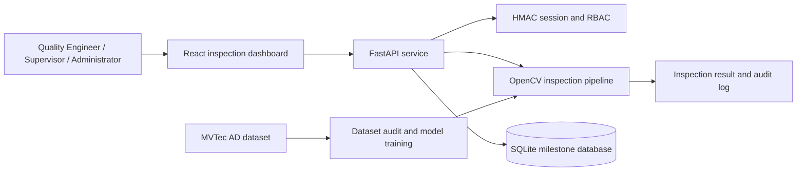

# VisionInspect AI Architecture

## Milestone 1 Scope

Milestone 1 establishes the local inspection workflow, role-based access, dataset integration, and persistent inspection records.

## Request Workflow

1. A user signs in through `POST /api/auth/login`.
2. The API validates the session and role permission.
3. The dashboard uploads an image with source, operator, and batch metadata.
4. The inspection pipeline validates and decodes the image, detects anomalies, classifies the result, calculates severity, and returns an annotated image.
5. The result and an audit event are stored in the database.
6. Authorized users view inspection history and analytics.

## Milestone Database Schema

- `users`: account identity, role, password hash, active state, and creation time.
- `inspections`: inspection identifier, timestamp, and serialized inspection result.
- `audit_log`: actor, action, timestamp, and structured metadata.

The schema is stored in [backend/schema.sql](../backend/schema.sql) and applied automatically when the API opens the database. SQLite keeps the milestone self-contained; the API boundary allows a production database to replace it later.

## Roles

- **Quality Engineer**: inspect images and view analytics.
- **Factory Supervisor**: inspect images, view analytics, and view audit events.
- **Administrator**: all supervisor permissions plus user management.

## Dataset Workflow

The MVTec AD directory is discovered relative to the backend source, so dataset audit and training work from either the repository root or `backend/`. The dataset itself remains local and ignored by Git because of its size and license requirements.
